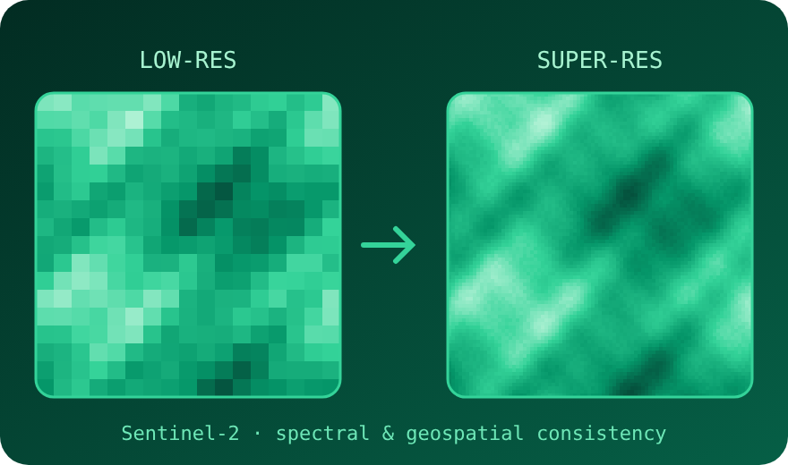

-047857?style=for-the-badge)

 

## 🍀 About me

<table>
  <tr>
    <td width="57%" valign="top">
      
Apart from my research interests, I like making random projects, DIY, reading <strong>manga / manhwa / manhua</strong> and <strong>web novels</strong>, and the list goes on. 
      Also, video games are fun. 🎮

    </td>
    <td width="43%" valign="top" align="center">
      
    </td>
  </tr>
</table>

 

## 🌳 Skill tree

<table>
  <tr>
    <td width="53%" valign="top">
      
      <h3>⚙️ Technical toolkit</h3>
      
<strong>Programming</strong> 
        
      

      
<strong>Development</strong> 
         
        Front-end development and web frameworks

      
<strong>Systems</strong> 
         
        Computer architecture fundamentals

      
<strong>ML &amp; data</strong> 
         
        Model experimentation · Data analysis · Remote sensing

      
<strong>Quantum tooling</strong> 
        
      

      

        
      

    </td>
    <td width="47%" valign="top">
      
      <h3>🔭 Research &amp; publications</h3>
      
<strong>Research directions</strong> Data science and trustworthy ML for remote sensing, especially spectral and geospatial consistency in satellite imagery; quantum technologies and hardware, including superconducting nanowire single-photon detectors (SNSPDs); and computer architecture.

      
<strong>Publications &amp; preprints</strong> None yet. Quest not started.

      
      
<strong>Other interests</strong> Biotech is an exploratory interest 🧬 (just curious for now, no public project to link yet).

      

        
      

    </td>
  </tr>
</table>

 

## 🎯 Focus areas

<table>
  <tr>
    <td width="20%" valign="top" align="center">
      <strong>🧠 AI/ML</strong>  
        
      Trustworthy satellite-image super-resolution.  
      <a href="https://github.com/Preet-Gandhi/TerraForge---Deep-Learning-for-Satellite-Image-Super-Resolution">TerraForge ↗</a>
    </td>
    <td width="20%" valign="top" align="center">
      <strong>⚛️ Quantum technologies</strong>  
      Quantum hardware and single-photon detectors.  
      <a href="#research">Research ↘</a>
    </td>
    <td width="20%" valign="top" align="center">
      <strong>🔧 Computer architecture &amp; hardware</strong>  
      Understanding computation below the software layer.  
      <a href="#toolkit">Toolkit ↘</a>
    </td>
    <td width="20%" valign="top" align="center">
      <strong>🤖 Robotics &amp; optimization</strong>  
      Task allocation, routing, and collision avoidance.  
      <a href="https://github.com/Preet-Gandhi/ACE---AMR-Collision-Avoidance-Efficiency_SIH_2026">ACE ↗</a>
    </td>
    <td width="20%" valign="top" align="center">
      <strong>🧬 Biotech</strong>  
      An exploratory interest, not a claimed project area.  
      <a href="#other-interests">Context ↘</a>
    </td>
  </tr>
</table>

 

## 🚀 Projects

<table>
  <tr>
    <td width="50%" valign="top">
      <h3><a href="https://github.com/Preet-Gandhi/TerraForge---Deep-Learning-for-Satellite-Image-Super-Resolution">🛰️ TerraForge ↗</a></h3>
      <strong>Satellite image super-resolution</strong>
      
Deep-learning approaches to Sentinel-2 satellite-image super-resolution, with attention to spectral and geospatial consistency.

      <a href="https://github.com/Preet-Gandhi/TerraForge---Deep-Learning-for-Satellite-Image-Super-Resolution">View repository →</a>
    </td>
    <td width="50%" valign="top">
      <h3><a href="https://github.com/Preet-Gandhi/ACE---AMR-Collision-Avoidance-Efficiency_SIH_2026">🤖 ACE ↗</a></h3>
      <strong>AMR collision avoidance &amp; efficiency</strong>
      
Multi-agent AMR simulation: auction-based task assignment, A* routing, time-indexed reservations, collision detection, and deadlock recovery.

      <a href="https://github.com/Preet-Gandhi/ACE---AMR-Collision-Avoidance-Efficiency_SIH_2026">View repository →</a>
    </td>
  </tr>
</table>

 

## 🎓 Education & recognition

<table>
  <tr>
    <td width="50%" valign="top">
      <strong>B.Tech. — Computer Science &amp; Engineering (AI/ML)</strong> 
      BML Munjal University 
      <em>Minor: Quantum Technology</em>
    </td>
    <td width="50%" valign="top">
      <strong>BS in Data Science and Applications</strong> 
      <a href="https://study.iitm.ac.in/ds/">IIT Madras</a> · Online programme
    </td>
  </tr>
</table>

**🏆 Recognition:** Dean’s List — Certificate of Excellence (2026)

 

Thanks for stopping by!

